Лабораторная работа № 1. Установка Debian на виртуальную машину и настройка SSH
Цель работы
Установить гипервизор VirtualBox, создать виртуальную машину с Debian, настроить сетевые подключения (NAT и Bridged), обновить систему и настроить удалённый доступ по SSH (по паролю и по ключу).
Используемые средства
Компонент	Версия
Гипервизор	Oracle VirtualBox 7.2.16
Гостевая ОС	Debian 13.7.0 (amd64)
Хост-система	Windows
---
1. Установка виртуальной машины
1.1. Установка VirtualBox
Установщик VirtualBox скачан с официального сайта virtualbox.org.
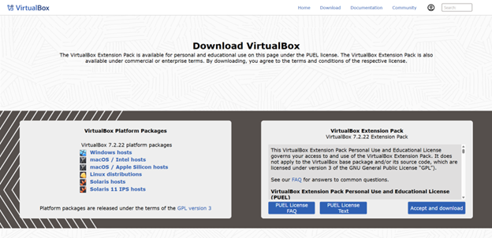
Установка выполнена со стандартными параметрами.
1.2. Создание виртуальной машины
Скачан ISO-образ Debian с debian.org. В VirtualBox создана новая виртуальная машина: указаны имя, тип (Linux / Debian 64-bit) и путь к ISO-образу.
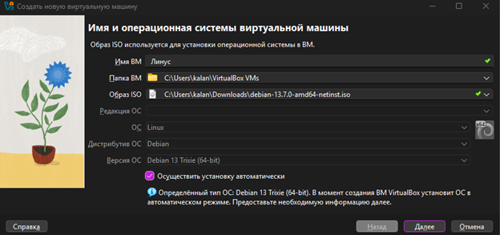
Заданы имя пользователя, пароль и имя компьютера (hostname).
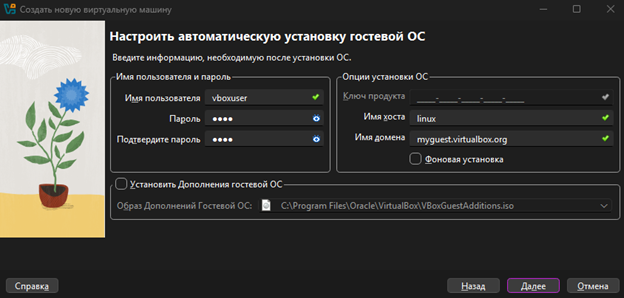
Выделены ресурсы виртуальной машины:
оперативная память: 4096 МБ
процессоры: 2
жёсткий диск: 30 ГБ
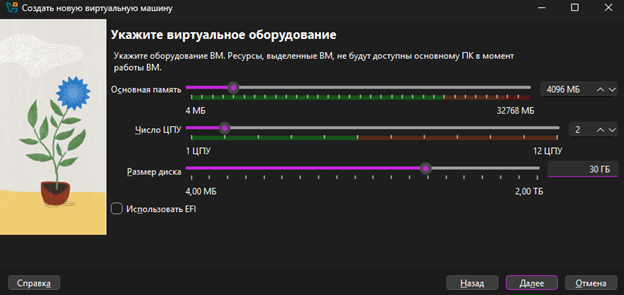
---
2. Установка Debian
После запуска ВМ выполнена установка Debian. Основные параметры системы:
Параметр	Значение
Имя компьютера	`Linux`
Язык	Русский / English
Часовой пояс	Asia/Krasnoyarsk
После завершения установки система загрузилась успешно:
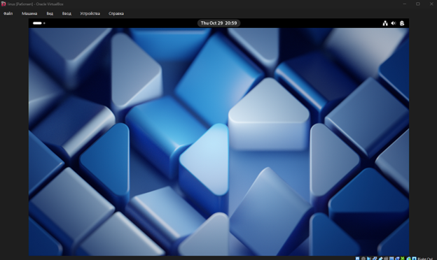
3. Настройка сети и обновление системы
3.1. Режим Bridged (сетевой мост)
В настройках ВМ: Сеть → Адаптер 1 → Тип подключения: Сетевой мост. В списке выбран физический адаптер хост-системы. В этом режиме ВМ получает IP-адрес из локальной сети.
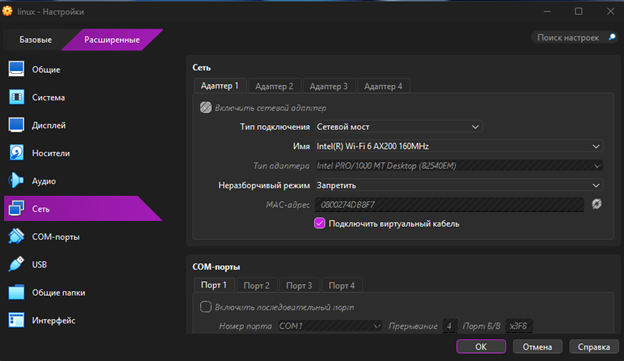
3.2. Обновление системы
Выполнено обновление списка пакетов и установленных пакетов:
```bash
sudo apt-get update
sudo apt-get upgrade -y
```
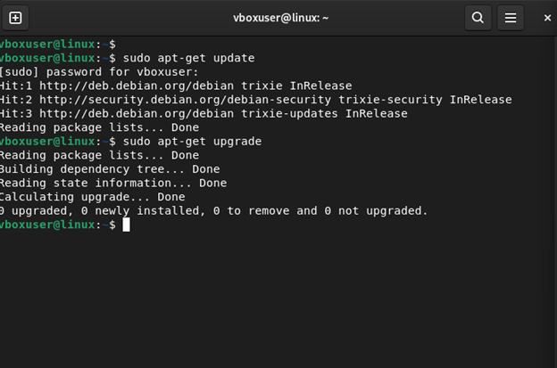
3.3. Режим NAT
В настройках ВМ: Сеть → Адаптер 1 → Тип подключения: NAT. В этом режиме ВМ выходит в интернет через хост, но подключиться к ней напрямую из локальной сети нельзя, поэтому для SSH далее настроен проброс порта.
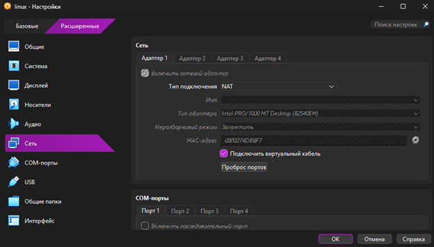
3.4. Проброс порта для режима NAT
Настроено правило: Сеть → Адаптер 1 → Дополнительно → Проброс портов.
Имя	Протокол	IP хоста	Порт хоста	IP гостя	Порт гостя
SSH	TCP	127.0.0.1	2222	(пусто или IP ВМ)	22
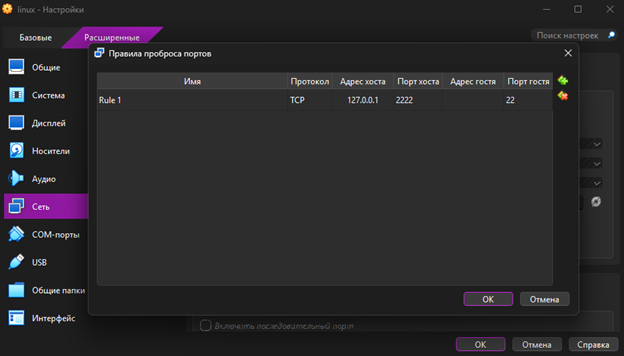
4. Настройка SSH
4.1. Установка SSH-сервера
```bash
sudo apt-get install openssh-server -y
```
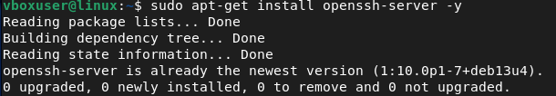
Служба включена и запущена:
```bash
sudo systemctl enable --now ssh
```
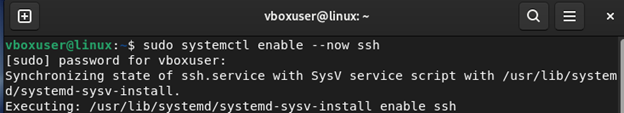
Проверка статуса (должно быть `active (running)`):
```bash
sudo systemctl status ssh
```
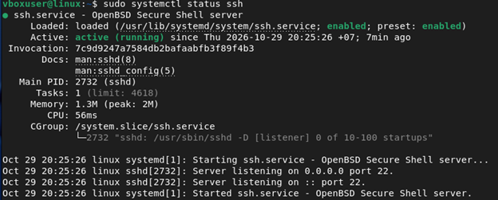
4.2. Подключение по паролю
Подключение с основного компьютера к виртуальной машине.
Режим NAT (через проброшенный порт):
```bash
ssh -p 2222 student@127.0.0.1
```
Режим Bridged:
```bash
ssh student@<IP\\\_ВМ>
```
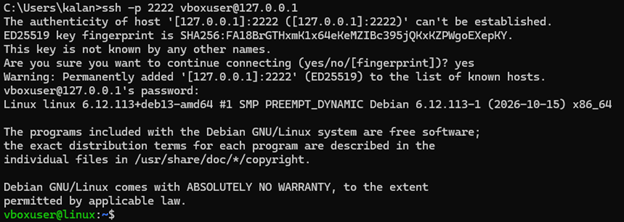
4.3. Подключение по ключу
Сгенерирована пара ключей на основном компьютере:
```bash
ssh-keygen -t ed25519 -C "student@lab"
```
Публичный ключ скопирован на виртуальную машину.
Linux / macOS / Git Bash:
```bash
ssh-copy-id -p 2222 student@127.0.0.1
```
Windows PowerShell:
```powershell
type $env:USERPROFILE\\\\.ssh\\\\id\\\_ed25519.pub | ssh -p 2222 student@127.0.0.1 "mkdir -p \\\~/.ssh \\\&\\\& cat >> \\\~/.ssh/authorized\\\_keys \\\&\\\& chmod 700 \\\~/.ssh \\\&\\\& chmod 600 \\\~/.ssh/authorized\\\_keys"
```
Проверка входа без запроса пароля:
```bash
ssh -p 2222 student@127.0.0.1
```
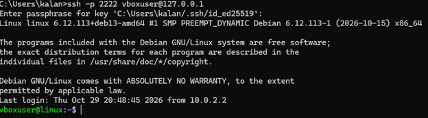
---
Вывод
В ходе лабораторной работы был установлен VirtualBox, создана виртуальная машина (X ГБ ОЗУ, 30 ГБ диск) и установлена ОС Debian. Были настроены сетевые режимы NAT и Bridged, выполнено обновление системы командами `apt-get update` и `apt-get upgrade`. Установлен и настроен SSH-сервер, настроен доступ с основного компьютера к виртуальной машине по паролю и по SSH-ключу.
